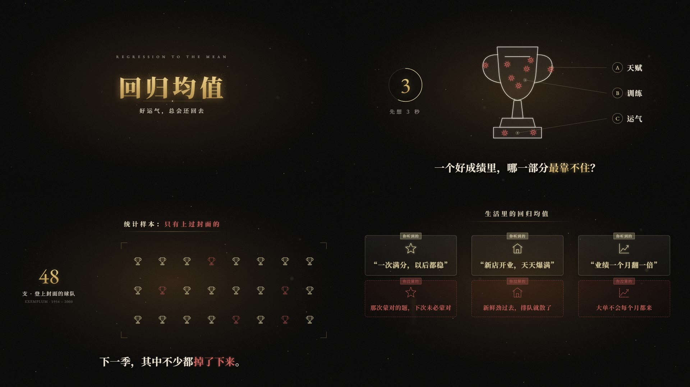

# 暗金图解风

暗金文献风的「图解」分支：同样是近黑底、暖光晕、金字、文献引用，但主角从金线图表换成了**象牙白线稿示意图**。题目被拆成「一张线稿 + 引线标注 + 一道选择题 + 一片样本方阵」，再用朱红把「看不见的那部分」画出来。适合讲统计、认知偏差、思维陷阱这类「把推理过程画出来」的反直觉知识，横屏 16:9，无口播，只靠字幕和配乐讲故事。

画面语法是从一支参考视频里拆出来的（`template/` 下的「幸存者偏差」，不进 git），组件和示例都是重写的，没有沿用原片的内容、文案、角色和水印。底层直接复用 `src/library/gilded/`（背景、浮尘、颗粒、年份抬头、文献引用、红章、标题卡），这里只补原片新增的语法。

## 画面特征

- **底色与质感**：和暗金一样，近黑 `#030303`，中间一团暖光晕（中心约 `#12110c`），四角压到 `#000407`，再叠浮尘和颗粒。线稿背后加一层**蓝图网格**：40px 方格，线色约 `rgba(239,230,210,0.05)`，越往外越淡，椭圆形淡出。
- **两种夜景**（开场和转折段用，冷调）：天空 `#050811`，楼体 `#15181f`；窗户分暖黄 `#b08a5a` 和冷灰蓝 `#8a8ea0` 两种，随机亮起；斜着落下细雨丝；远处是一层层群山剪影。
- **配色**：
  - 象牙白 `#f8f4eb`：线稿描边、正文；
  - 香槟金 `#dacc9d`：字幕重点词、标签、选项圈，比暗金原版的 `#f6d98c` 更淡、更偏米色；
  - 朱红 `#d0605a`：弹孔标记、「被排除 / 看不见 / 没进样本」的东西，一律配**虚线**；
  - 冷蓝：只出现在夜景里。
  - 规则：**金 = 看得见的，红虚线 = 看不见的**。同一画面里两种成对出现，形成「你看到的 / 你没看到的」的对照。
- **字体**：中文一律粗宋，西文和数字用 Garamond，西文名和英文注释用斜体。字号分五级（1920 宽）：
  - 片名 130px，字距 0.14em，金色渐变发光；
  - 字幕 56px（暗金原版是 42px，这里明显更大）；
  - 选项和标注 40px；
  - 小节标题 34px，字距 0.3em，下面压一条金色细线；
  - 卡片小签、英文注释 18～22px。
- **固定版式**：
  - 左上：年份抬头（同暗金）；夜景里换成「楼层 / 高度」计数器。
  - 右上：文献引用，和暗金不同的是上面多一行**朱红小字导语**，字距 0.3em。
  - 底部：中文字幕，y≈920，没有英文行。
  - 中间：主视觉。线稿居中偏左（约占画宽 1/3），右边三条引线标注，左边放倒计时圈或人物名牌。
- **出场方式**：
  - 元素柔入：透明度 + 模糊 + 上浮 12px，约 14 帧完成，缓动 ease-out 三次方；
  - 线稿描边先在约 30 帧内画出来，填色再淡入；
  - 引线从部件上的点画到标签，约 12 帧；
  - 红章 5 帧砸下：从 1.5 倍缩到 1 倍，带一点晃动；
  - 样本方阵里的项目逐个柔入，每个错开 2 帧；
  - 变红的项目先闪一下红光，再换成红色虚线；
  - 卡片两两出现：先出上面的金卡，约 20 帧后出下面的红色虚线卡。
- **转场**：146 秒只有 7 个硬切，全挤在前 38 秒的开场段；之后 108 秒是一个长镜头，靠元素进出和模糊交叉淡化换内容。片名出场用「**闪白 → 光环扩散 → 金粒子聚成字**」：先全屏闪白 3 帧，再用约 30 帧聚拢成字。段落之间会插 1～2 秒的空场，只剩浮尘。
- **镜头**：大部分时间静止，只有每段 2～3% 的慢推。开场夜景是竖直方向的长摇：楼层数字跟着往下滚。
- **节奏**：配乐约 129 BPM，一拍 0.464 秒，整片响度约 −14 LUFS。字幕一句约 3 秒，换句时直接替换，新句逐字柔入。三处卡点：开场的下落镜头硬切在第一个重拍上（3.5 秒）；片名闪白踩在重拍上（20.05 秒）；倒计时 3→2→1 每 0.8 秒一跳，跳在拍点上。
- **招牌画面**：
  1. 线稿 + 红色弹孔标记 + A/B/C 引线标注，左边一个倒计时圈；
  2. 样本方阵：四角取景框里排满同一个图标，其中几个变成红色虚线；
  3. 「你听到的 / 你没听到的」成对卡片：上面是金色玻璃卡，下面是红色虚线卡；
  4. 流程图：几个节点用虚线箭头串起来，中间一个格子盖上红章「没有记录」。

## 组件

| 文件 | 组件 |
|---|---|
| `src/library/gilded-diagram/theme.ts` | `D` 配色（象牙线稿、香槟金、标记红、玻璃卡、夜景色）、`rise` 柔入 + 上浮、`draw` 描边进度、`tick` 倒计时数字 |
| `src/library/gilded-diagram/stage.tsx` | `DCaption` 大字幕（`【金】`、`〔红〕`）、`SectionTitle` 小节标题、`KickerCite` 带朱红导语的文献引用、`BlueprintGrid` 蓝图网格、`CornerFrame` 四角取景框、`FlashTitle` 闪白聚字片名、`Counter` 左上计数抬头、`NightCity` 夜景楼群、`Ridges` 群山剪影、`DotMap` 点阵地图 + 弧线航线 |
| `src/library/gilded-diagram/props.tsx` | `LineArt` 线稿（描边画出、可切红虚线）、`HitMark` 弹孔标记、`Callout` 引线标注（未选 / 选中 / 排除 / 正确四态）、`CountRing` 倒计时圈、`NameCard` 人物名牌、`Tag` 小方签、`FrameStamp` 矩形红章、`ClaimCard` 成对卡片、`Checklist` 勾选清单、`Gauge` 竖向量表、`Ivory` 象牙白剪影容器 |
| `src/library/gilded-diagram/charts.tsx` | `IconGrid` 样本方阵（逐个出现、按下标变红虚线）、`BigCount` 大数字计数、`FlowRow` 虚线流程图（节点 + 箭头 + 移动的小标记） |

## 关键代码

- 素材库：`src/library/gilded-diagram/`（目录见 `src/library/README.md`「暗金图解风」一节），底层复用 `src/library/gilded/`
- 预览：Studio 里的 `library-gilded-diagram`（`src/library/previews/GildedDiagramDemo.tsx`，55 秒，11 场把所有组件演一遍）

## 没有搬的东西

- **内容**：原片的题目（幸存者偏差）、所有字幕文案、片名、系列名、集数、参考文献，一样没用。预览换了题目，讲的是「回归均值」，人名和书名都写成「示例人物」「示例文献」。
- **角色和道具**：原片里的猫剪影、轰炸机线稿、还愿画、皇冠和房子图标都没有画。线稿组件只收任意 SVG 路径；预览里的线稿（奖杯、小鸟、球衣）是新画的。
- **地图**：点阵地图用程序噪声生成抽象的「大陆」，不对应任何真实的国界或海岸线。
- **水印和品牌**：原片的系列名和水印没有复制。
- **配乐**：原片配乐没有进素材包。只记录了它的节奏特征（约 129 BPM、重拍上闪白），要用就走音乐库 `public/music/`，用自己有授权的曲子。

## 期数

还没有正式使用的期数。
